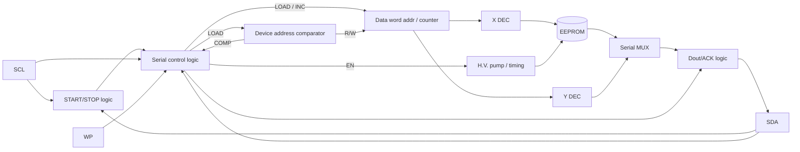
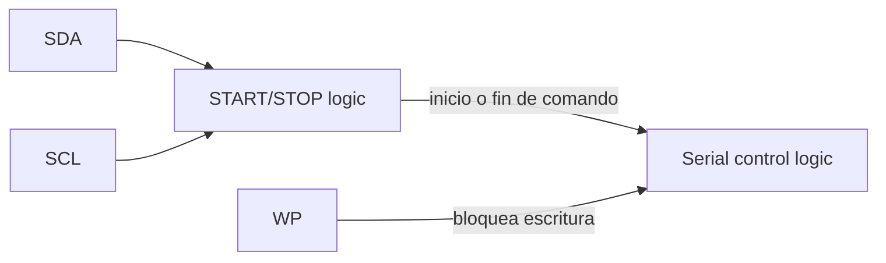
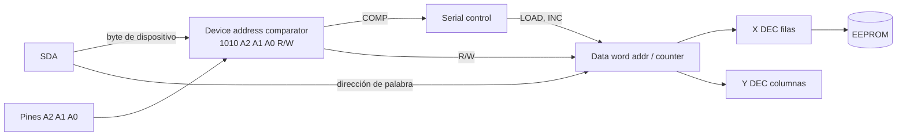
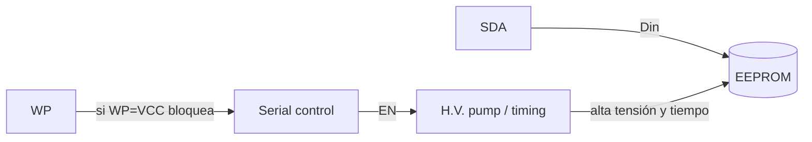
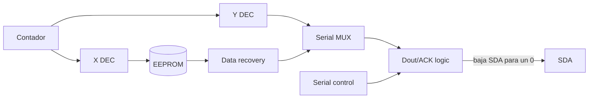
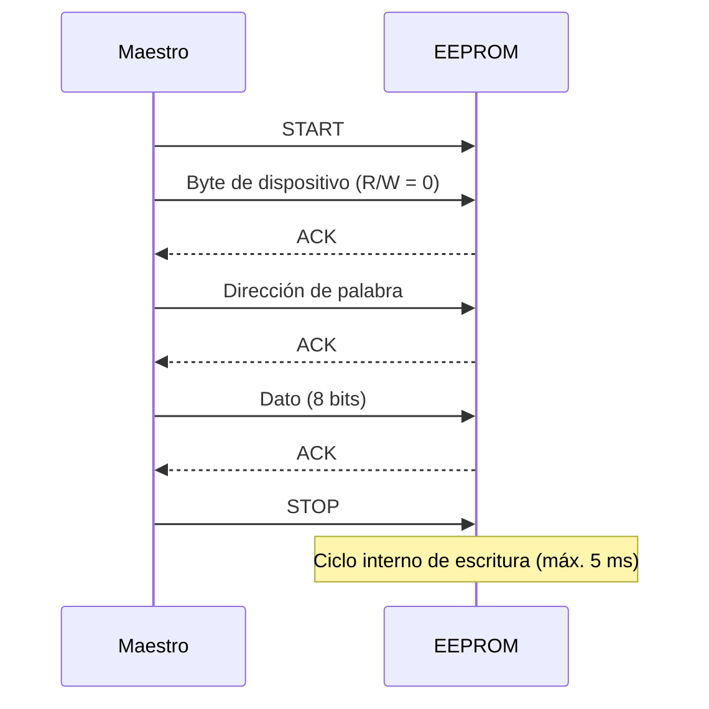
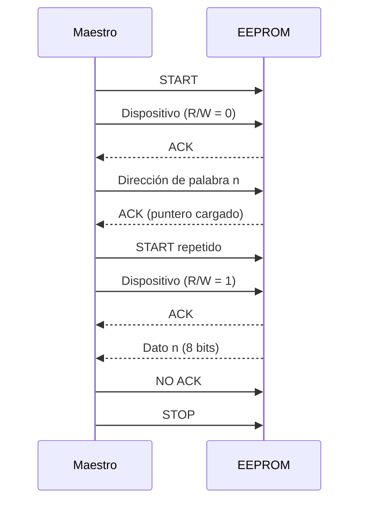
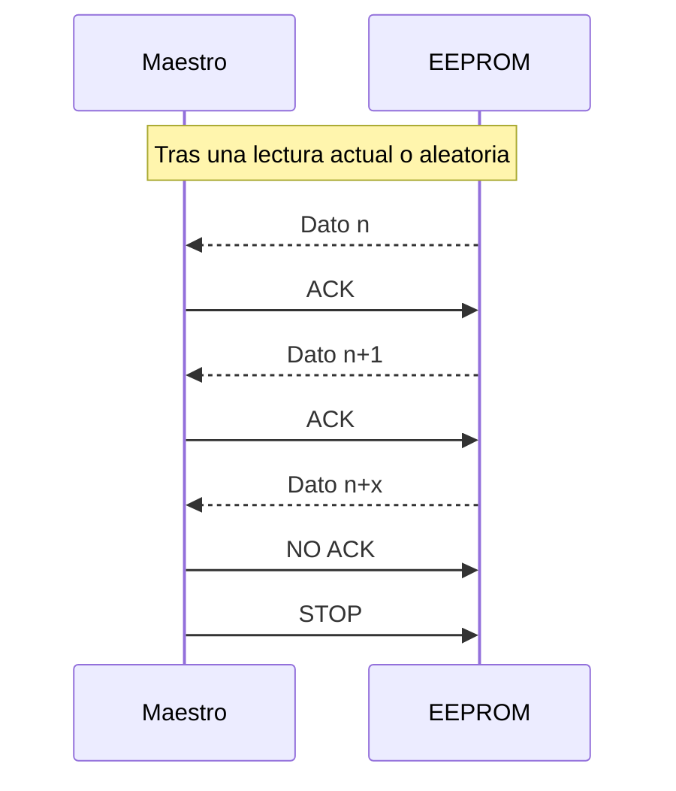

Almacenamiento, Guardado y Recuperación de Puntuaciones (*Scores*)

### 2.1. ¿Dónde se almacena el Score?
El puntaje del juego posee dos niveles de almacenamiento:
1. **Volátil (RAM del Procesador):** Durante el transcurso de la partida, la puntuación se actualiza en tiempo real en registros y variables alojadas en la memoria RAM interna del procesador SoC.
2. **No Volátil (Memoria EEPROM Externa 24LCxx o 24Cxx):** Al finalizar la partida, el puntaje es transferido mediante el periférico `perip_i2c_master` hacia una memoria EEPROM externa conectada en la dirección `0x50`, garantizando que los récords persistan aunque el sistema se apague.
La disposición de los pines y su coneccion se puede describir de la siguiente manera:
## 3. Pines y conexión
 
| Pin | Función |
|---|---|
| **SCL** | Reloj serie. Los datos **entran** por flanco de subida y **salen** por flanco de bajada. |
| **SDA** | Datos bidireccionales, de **drenador abierto**. Puede compartirse con otros dispositivos open-drain; requiere resistencia de pull-up externa. |
| **A2, A1, A0** | Dirección física del dispositivo, cableada a VCC o GND. Permiten hasta 8 chips de 1K/2K en el mismo bus. |
| **WP** | Protección de escritura. A **VCC** protege toda la matriz; a **GND** permite lectura y escritura normal. |
| **VCC / GND** | Alimentación y tierra. |
 
---
 
## 4. Diagrama de bloques
 
**[IMAGEN]** Figura 1 del datasheet: *Block Diagram* (p. 2).
 
### 4.1 Descripción general
 
El chip recibe por SCL y SDA los comandos del maestro. La lógica de control interpreta el comando, valida la dirección del dispositivo, maneja un contador interno de dirección y activa, según el caso, la ruta de **escritura** (bomba de alta tensión) o la ruta de **lectura** (decodificadores, multiplexor y salida).
 
### 4.2 Bloques
 
| Bloque | Función |
|---|---|
| **START/STOP logic** | Vigila SCL y SDA para detectar las condiciones de **START** y **STOP**, e informa a la lógica de control. |
| **Serial control logic** | Unidad de control (máquina de estados). Recibe SCL, SDA y WP, y genera las señales **LOAD**, **INC** y **EN**. Coordina todo el chip. |
| **Device address comparator** | Compara los 7 bits recibidos (`1010` + A2A1A0) con los pines físicos. Si coinciden produce **COMP** y el chip responde. También separa el bit **R/W**. |
| **Data word addr/counter** | Contador que guarda la dirección de la palabra de memoria. Se carga con **LOAD** y se incrementa con **INC**; es el **puntero autoincremental**. |
| **X DEC / Y DEC** | Decodificadores de **filas** y **columnas**; con la dirección del contador seleccionan la celda en la matriz. |
| **EEPROM + Data recovery** | Matriz de memoria y amplificadores de lectura que recuperan el dato almacenado. |
| **Serial MUX** | Selecciona el bit de la palabra leída que se envía hacia la salida. |
| **H.V. pump/timing** | Bomba de carga y temporización para programar celdas. La activa la señal **EN**. Es el origen del ciclo interno autotemporizado (t_WR ≤ 5 ms). |
| **D_OUT/ACK logic** | Maneja SDA en la salida: coloca los bits de lectura y genera el **ACK** (un cero en el noveno pulso). Actúa sobre un transistor a tierra, por eso SDA es de drenador abierto. |
 
### 4.3 Señales internas
 
| Señal | Origen → Destino | Significado |
|---|---|---|
| **EN** | Control → H.V. pump | Habilita la programación (escritura). |
| **LOAD** | Control → Comparador y Contador | Carga el byte recibido (dirección de dispositivo o de palabra). |
| **INC** | Control → Contador | Incrementa la dirección tras cada byte. |
| **COMP** | Comparador → Control | La dirección del dispositivo coincide. |
| **R/W** | Comparador → Contador y D_OUT/ACK | Indica si la operación es de lectura o escritura. |
 
---
 
## 5. Subdiagramas
 
Para explicar mejor el diagrama original, se divide en cinco vistas.
 
### 5.1 Vista general simplificada
 

 
### 5.2 Detección de START/STOP y control
 

 
**Proceso:** la lógica de START/STOP detecta los flancos de SDA con SCL en alto y notifica a la lógica de control, que inicia o termina el comando. El pin WP llega directamente a la lógica de control para bloquear las escrituras.
 
### 5.3 Ruta de direccionamiento
 

 
**Proceso:** el comparador valida el byte de dispositivo contra los pines A2, A1 y A0. Si hay coincidencia, el chip responde con ACK. La dirección de palabra se carga en el contador, y sus bits se reparten entre el decodificador de filas (X) y el de columnas (Y), que seleccionan la celda.
 
### 5.4 Ruta de escritura
 

 
**Proceso:** tras recibir el STOP de una escritura, la lógica de control activa **EN**. La bomba de carga genera la alta tensión y el temporizador controla el ciclo de programación (hasta 5 ms), en el que las entradas se deshabilitan y el chip no responde. Si WP está a VCC, la escritura se bloquea.
 
### 5.5 Ruta de lectura
 

 
**Proceso:** el contador apunta con X DEC la fila de la matriz, y el bloque de recuperación entrega el dato. Con Y DEC, el multiplexor serie elige el bit correspondiente, y D_OUT/ACK logic lo coloca en SDA llevando la línea a tierra cuando el bit es 0 (el 1 lo genera el pull-up externo).
 
---
 
## 6. Fundamentos de la señal I2C
 
**[IMAGEN]** Figuras 4, 5 y 6 del datasheet: *Data Validity*, *Start and Stop Definition* y *Output Acknowledge* (p. 7 y 8).
 
| Elemento | Descripción |
|---|---|
| **Validez de datos** | SDA solo puede cambiar mientras SCL está en **bajo**. Con SCL en alto, SDA debe permanecer estable. |
| **START** | SDA pasa de alto a bajo con SCL en alto. Precede a cualquier comando. |
| **STOP** | SDA pasa de bajo a alto con SCL en alto. Tras una lectura, deja el chip en modo standby. |
| **ACK** | Todo byte (8 bits) se confirma con un **0** en el noveno pulso de SCL, generado por el receptor. |
| **NO ACK** | El receptor deja SDA en alto en el noveno pulso. En lectura, el maestro lo usa para indicar el final. |
| **Standby** | Se activa al encender y tras recibir un STOP y terminar las operaciones internas. |
| **Reset de memoria** | Tras una interrupción del protocolo o corte de energía: hasta 9 pulsos de SCL comprobando SDA alto, y luego un START. |
 
### 6.1 Direccionamiento del dispositivo
 
**[IMAGEN]** Figura 7 del datasheet: *Device Address* (p. 11).
 
Tras el START, el maestro envía un byte de dispositivo: los 4 bits altos son siempre **`1010`**, los siguientes 3 bits son A2, A1, A0 (o bits de página P en los modelos de mayor capacidad) y el último es **R/W**: `0` para escritura, `1` para lectura. Si la dirección no coincide, el chip vuelve a standby sin responder.
 
Ejemplo con el chip en `A2 A1 A0 = 000`: escritura `0xA0`, lectura `0xA1`.
 
---
 
## 7. Modos de operación
 
### 7.1 Escritura
 
#### 7.1.1 Escritura de byte (Byte Write)
 
**[IMAGEN]** Figura 8 del datasheet: *Byte Write* (p. 11).
 
| Fase | Bits en SDA | Maneja SDA |
|---|---|---|
| START | SDA ↓ con SCL alto | Maestro |
| Byte de dispositivo | `1 0 1 0 A2 A1 A0 0` | Maestro |
| ACK | `0` | EEPROM |
| Dirección de palabra | 8 bits (MSB primero) | Maestro |
| ACK | `0` | EEPROM |
| Dato | 8 bits | Maestro |
| ACK | `0` | EEPROM |
| STOP | SDA ↑ con SCL alto | Maestro |
 
Con el STOP comienza el ciclo interno de escritura (t_WR ≤ 5 ms), durante el cual el chip no responde.
 

 
#### 7.1.2 Escritura por página (Page Write)
 
**[IMAGEN]** Figura 9 del datasheet: *Page Write* (p. 11).
 
Se inicia igual que el byte write, pero el maestro **no envía STOP** tras el primer dato. Mientras la EEPROM responda ACK, el maestro puede enviar:
 
- hasta **7 datos más** en 1K/2K (página de 8 bytes), o
- hasta **15 datos más** en 4K/8K/16K (página de 16 bytes).
Tras cada dato, el contador incrementa solo los **3 bits bajos** (1K/2K) o **4 bits bajos** (4K/8K/16K) de la dirección; los bits altos, que identifican la página, no cambian. Si se envían más bytes que el tamaño de página, la dirección **da la vuelta** al inicio de la misma página y se sobrescriben los datos anteriores. La secuencia termina con **STOP**.
 
#### 7.1.3 Sondeo por ACK (Acknowledge Polling)
 
Una vez iniciado el ciclo interno de escritura, el maestro puede enviar repetidamente **START + byte de dispositivo**. El chip responde con ACK (0) **solo cuando terminó** el ciclo interno. Permite continuar tan pronto como la memoria esté lista, sin esperar el máximo de 5 ms.
 
### 7.2 Lectura
 
En todas las lecturas el bit R/W del byte de dispositivo es **1**.
 
#### 7.2.1 Lectura de dirección actual (Current Address Read)
 
**[IMAGEN]** Figura 10 del datasheet: *Current Address Read* (p. 12).
 
El contador interno mantiene la última dirección accedida, incrementada en uno, mientras el chip esté alimentado. La lectura entrega el byte de esa dirección.
 
| Paso | Acción |
|---|---|
| 1 | START |
| 2 | Maestro: byte de dispositivo con R/W = 1 |
| 3 | EEPROM: ACK |
| 4 | EEPROM: entrega 8 bits de dato |
| 5 | Maestro: **NO ACK** (deja SDA en alto) |
| 6 | STOP |
 
#### 7.2.2 Lectura aleatoria (Random Read)
 
**[IMAGEN]** Figura 11 del datasheet: *Random Read* (p. 12).
 
Para leer una dirección específica hay que cargar primero el puntero con una **escritura ficticia (dummy write)**, sin llegar a escribir ningún dato.
 
| Paso | Acción |
|---|---|
| 1 | START |
| 2 | Byte de dispositivo con **R/W = 0** → ACK |
| 3 | Dirección de palabra (8 bits) → ACK. El puntero queda cargado. |
| 4 | **START repetido** (sin STOP intermedio) |
| 5 | Byte de dispositivo con **R/W = 1** → ACK |
| 6 | EEPROM entrega el dato de la dirección cargada |
| 7 | Maestro: **NO ACK** |
| 8 | STOP |
 

 
**Qué ocurre en los bloques:** el comparador valida el byte de dispositivo y genera COMP; la lógica de control activa **LOAD** y el contador toma la dirección de palabra; como el primer R/W es 0 no se escribe nada. El START repetido y el nuevo byte con R/W = 1 cambian el modo a lectura: el contador apunta con X DEC y Y DEC, la matriz entrega el dato, el Serial MUX lo serializa y D_OUT/ACK logic lo coloca bit a bit en SDA.
 
#### 7.2.3 Lectura secuencial (Sequential Read)
 
**[IMAGEN]** Figura 12 del datasheet: *Sequential Read* (p. 12).
 
Se inicia como una lectura actual o aleatoria. La diferencia está en lo que el maestro hace en el noveno pulso tras cada byte:
 
| Paso | Acción |
|---|---|
| 1 | El maestro recibe el dato n |
| 2 | Responde **ACK** (0) |
| 3 | La EEPROM **incrementa el contador** (INC) y entrega el dato n+1 |
| 4 | Se repite mientras el maestro responda ACK |
| 5 | Para terminar: **NO ACK** y **STOP** |
 

 
Al llegar al límite de la memoria, la dirección **da la vuelta** del último byte de la última página al primer byte de la primera página, y la lectura continúa. A diferencia de la escritura por página, el puntero en lectura recorre **toda la memoria**.
 
### 7.3 Resumen de modos
 
| Modo | R/W | Puntero | Termina con |
|---|---|---|---|
| Byte write | 0 | Dirección explícita | STOP |
| Page write | 0 | Autoincremento **dentro de la página** | STOP |
| Acknowledge polling | 0 o 1 | No cambia | ACK de la EEPROM |
| Current address read | 1 | Última dirección + 1 | NO ACK + STOP |
| Random read | 0 → 1 | Cargado con dummy write | NO ACK + STOP |
| Sequential read | 1 | Autoincremento en **toda la memoria** | NO ACK + STOP |
 
---
 
## 8. Temporización
 
**[IMAGEN]** Figuras 2 y 3 del datasheet: *Bus Timing* y *Write Cycle Timing* (p. 7). Tabla 5, *AC Characteristics* (p. 5).
 
| Parámetro | 1.8 V | 2.7 V a 5 V |
|---|---|---|
| f_SCL máx. | 100 kHz | 400 kHz |
| t_LOW mín. | 4.7 µs | 1.2 µs |
| t_HIGH mín. | 4.0 µs | 0.6 µs |
| t_SU.STA mín. | 4.7 µs | 0.6 µs |
| t_HD.STA mín. | 4.0 µs | 0.6 µs |
| t_SU.DAT mín. | 200 ns | 100 ns |
| t_HD.DAT mín. | 0 | 0 |
| t_SU.STO mín. | 4.7 µs | 0.6 µs |
| t_BUF mín. | 4.7 µs | 1.2 µs |
| t_AA (SCL bajo → dato válido) | 0.1 a 4.5 µs | 0.1 a 0.9 µs |
| t_DH mín. | 100 ns | 50 ns |
| t_WR máx. | 5 ms | 5 ms |
 
---
 
## 9. Consideraciones para el driver I2C de KUBIX
 
- **SDA en drenador abierto:** el maestro solo debe manejar SDA llevándola a 0 o liberándola (alta impedancia). Nunca forzar un 1.
- **Pull-ups:** SDA y SCL requieren resistencias de pull-up a VCC.
- **Velocidad:** comenzar en 100 kHz, dividiendo el reloj de la FPGA, y subir a 400 kHz si los tiempos de subida lo permiten.
- **Dirección fija:** definir A2, A1, A0 (por ejemplo `000`) y fijar WP a GND o a un pin de control.
- **Fin de escritura:** preferir el sondeo por ACK a esperas fijas.
- **Desgaste:** la memoria soporta 1 millón de ciclos de escritura; conviene escribir solo cuando hay un puntaje nuevo que entre en el ranking.
- **Recuperación:** ante un fallo o corte de energía, aplicar el reset de memoria (hasta 9 pulsos de SCL y un START).
---
 
## 10. Referencias
 
- Atmel Corporation. *AT24C01A/02/04/08A/16A, Two-wire Serial EEPROM*. Hoja de datos 0180V-SEEPR-8/0
